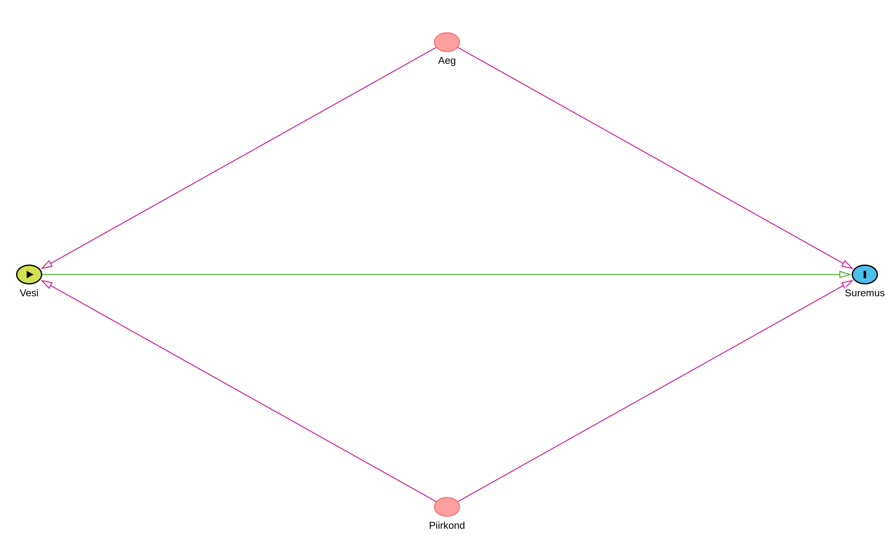

```{r setup, include=FALSE}
knitr::opts_chunk$set(echo = TRUE, warning = FALSE, message = FALSE)
library(causaldata)
library(dplyr)
library(knitr)
library(ggplot2)
```

# 1. Uurimisprobleemi lühikirjeldus

Käesolev lühiprojekt hindab puhta joogivee mõju koolerasurmadele, tuginedes John Snow klassikalisele 1855. aasta uuringule. 19. sajandi keskel arvati, et koolerat põhjustab saastunud õhk (miasmi teooria). John Snow püstitas aga hüpoteesi, et haigust levitab saastunud vesi. 

Probleemi uurimiseks kasutatakse 1849. ja 1854. aasta Londoni koolerapuhangute andmeid. Mõlemal aastal varustasid Lõuna-Londonit veega kaks peamist ettevõtet: Lambeth ja Southwark & Vauxhall (S&V). 1849. aastal võtsid mõlemad ettevõtted oma vee Thamesi jõest Londoni kesklinna reostunud piirkonnas. 1852. aastal kolis Lambethi ettevõte oma veevõtukoha ülesvoolu, eemale linna reoveest, pakkudes 1854. aasta puhangu ajal puhast vett. S&V veevõtukoht jäi aga samaks.

Uurimuse eesmärk on hinnata veekvaliteedi parandamise ("sekkumine") kausaalset mõju koolerasurmade määrale piirkondades, mida varustas osaliselt Lambethi ettevõte, võrreldes piirkondadega, kus vee pakkujaks oli vaid S&V. Analüüs viiakse läbi kasutades erinevused-erinevustes (Difference-in-Differences, DID) meetodit.

# 2. Valimi kirjeldav statistika

Kasutame paketist `causaldata` pärit andmestikku `snow`, mis sisaldab agregeeritud andmeid koolerasurmade kohta Londonis. See koosneb neljast vaatlusest, mis hõlmavad kahte aastat ja kahte veepakkuja gruppi.

```{r descriptive}
# Valmistame andmestiku ette
data("snow")
snow_data <- snow %>%
  mutate(
    Post = ifelse(year == 1854, 1, 0),
    Treated = ifelse(supplier == "Lambeth + Others", 1, 0)
  )

kable(snow_data, caption = "John Snow koolerauuringu andmed")
```

Nagu näha, on andmestikus toodud surmade arv 10 000 elaniku kohta (`deathrate`) aastatel 1849 ja 1854 piirkondade lõikes, mida varustasid erinevad ettevõtted. 1849. aastal oli suremus mõlemas grupis sarnane (ca 130-135 surma). 1854. aastaks langes see "Lambeth + Others" (Treated) piirkonnas drastiliselt.

# 3. Kausaalse identifitseerimise strateegia

Kausaalseks hindamiseks kasutatakse erinevused-erinevustes (DID) meetodit. Sekkumiseks loetakse Lambethi ettevõtte veevõtukoha puhtamasse piirkonda kolimist.

## 3.1. Kausaalse disaini võtmeelemendid

| Element | Kirjeldus |
|---------|-----------|
| **(1) Sekkumine (Treatment)** | Puhtama joogivee tagamine (veevõtukoha viimine Thamesi jõel ülesvoolu). |
| **(2) Kellele kohaldati** | Piirkondadele, kus üheks veepakkujaks oli Lambethi vee-ettevõte. |
| **(3) Kontroll- ja mõjugrupp** | **Mõjugrupp (Treated):** "Lambeth + Others" piirkonnad. <br> **Kontrollgrupp (Control):** "Non-Lambeth Only" (S&V) piirkonnad. |
| **(4) Väljundtunnus (Outcome)** | Koolerasurmade arv 10 000 elaniku kohta (`deathrate`). |
| **(5) Kontrolltunnused** | Agregeeritud andmestikus puuduvad lisakontrolltunnused, DID mudel eemaldab iseenesest ajas püsivad grupi eripärad ja üleüldise ajatrendi. |

## 3.2. Kausaalse hindamise eeldused

DID meetodi rakendamiseks on vajalik, et oleksid täidetud teatud eeldused:
1. **Paralleelsete trendide eeldus (Parallel trends assumption):** Kui Lambethi ettevõte poleks oma veevõtukohta muutnud, oleks koolerasurmade trend mõlemas piirkonnas olnud ajas sarnane. Seda toetab asjaolu, et mõlemad piirkonnad asusid samas linnas ja olid sotsiaal-demograafiliselt võrreldavad. 1849. aasta andmed (enne sekkumist) näitavad, et stardipositsioon (suremus) oli sarnane.
2. **Sekkumise sõltumatuse eeldus (Exogeneity of intervention):** Veevõtukoha muutus ei tohtinud olla põhjustatud varasemast koolerasurmade erinevusest piirkondade vahel, vaid ettevõtte operatiivsest otsusest (varasemast parlamendi seadusest). See eeldus on ajalooliselt tõestatud.

## 3.3. Suunatud atsükliline graaf (DAG)





*Graafiku tõlgendus: Piirkond (mõjugrupp vs kontrollgrupp) ja Aeg (1849 vs 1854) mõjutavad seda, missuguse veevõtukohaga vesi elanikeni jõuab, ning ühtlasi mõjutavad need tunnused ka haiguse levikut (suremust). Veevõtukoha puhtus on otsene põhjus (exposure), mis mõjutab suremust (outcome).*

# 4. Kausaalne hindamine R-is

Viime läbi DID regressioonianalüüsi. Mudeliks on:
$Deathrate = \beta_0 + \beta_1 Post + \beta_2 Treated + \beta_3 (Post \times Treated) + \epsilon$

Kausaalne mõju on $\beta_3$.

```{r analysis}
did_model <- lm(deathrate ~ Post * Treated, data = snow_data)
summary(did_model)
```

# 5. Uurimistulemused ja järeldused

Järgneval joonisel on kujutatud surmade arvu muutus.

```{r plot, echo=FALSE, fig.cap="Suremuse muutus DID mudelis"}
ggplot(snow_data, aes(x = year, y = deathrate, color = factor(Treated, labels=c("Kontroll (S&V)", "Mõjugrupp (Lambeth)")))) +
  geom_line(linewidth = 1.2) +
  geom_point(size = 3) +
  scale_x_continuous(breaks = c(1849, 1854)) +
  labs(y = "Surmi 10 000 inimese kohta", x = "Aasta", color = "Piirkond") +
  theme_minimal()
```

Regressioonitulemused näitavad, et enne sekkumist 1849. aastal oli baassuremus kontrollgrupis 134,9. Aeg ($Post$) tõstis kontrollgrupis suremust 11,7 võrra. Mõjugrupi eripära ($Treated$) viitab, et baassuremus oli algselt -4,8 võrra madalam (statistiliselt mitteoluline vahe).

**Kausaalne mõju (DID hinnang):** Sekkumise ehk puhta vee pakkumise spetsiifiline efekt ($Post \times Treated$) on **-56,9**. See tähendab, et puhta vee tagamine vähendas koolerasurmasid hinnanguliselt 56,9 inimese võrra 10 000 elaniku kohta.

**Tulemuste usaldusväärsus:** Kuna andmestikus on vaid 4 agregeeritud vaatlust, siis ei ole regressioonis vabadusastmeid ning standardvead ja p-väärtused on "NaN" (Not a Number). Sellele vaatamata illustreerib efektisuurus väga tugevat kausaalset seost, mida on ajalooliselt korduvalt kinnitatud täpsemate andmetega. Paralleelsete trendide eeldus on usutav, kuna Lambethi piirkonna puhtam vesi oli ainus suur muutuja nende piirkondade vahel sel ajavahemikul.

Seega saab järeldada, et sekkumine (puhtam vesi) vähendas drastiliselt haigestumist, kinnitades John Snow hüpoteesi koolera veega levimise kohta.
